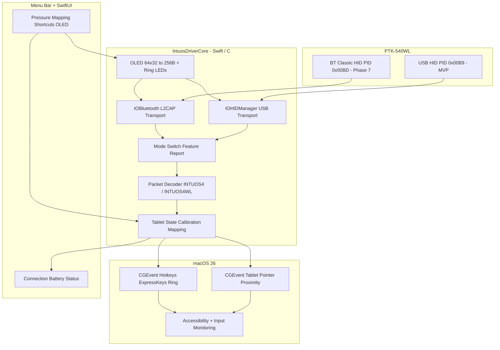

# Native Apple Silicon macOS Driver Plan: Wacom Intuos4 Wireless (PTK-540WL)

## 1. Goal

Build a **native arm64, user-space** driver and companion app for the **Wacom Intuos4 Wireless (PTK-540WL)** on **macOS 26 only** (target machine: macOS 26.4.1).

- Real HID I/O — not Rosetta, not the legacy Intel installer, not KEXT workarounds.
- MVP priority: **USB first**, then Bluetooth Classic.
- Drawing targets: **Adobe Photoshop / Illustrator** plus broad pro apps (Krita, Clip Studio, Affinity, Apple Notes).

Legacy reference in-tree: `Lates known driver not for Apple silicon/WacomTablet_6.3.41-2.dmg` (v6.3.41-2). That package is `hostArchitecture="x86_64"`, requires restart, ships `SiLabsUSBDriver64.kext`, daemons, and a deprecated `.prefPane`.

Related note: `driver.md` — native connection on Apple Silicon, not simulation of the old driver.

---

## 2. Decisions (locked)

| Decision | Choice |
| :--- | :--- |
| Architecture | Native `arm64` only (no universal / Intel requirement) |
| Minimum OS | **macOS 26** only |
| Driver model | User-space only (`IOHIDManager`, later `IOBluetooth` L2CAP). No KEXT, no SIP off |
| MVP transport | **USB first** (PID `0x00B9`), then Bluetooth Classic (PID `0x00BD`) |
| App integration | Real tablet events for **Adobe + broad pro apps** (not cursor-only MVP) |
| Protocol source of truth | **linuxwacom** (`wacom_wac.c` / `INTUOS4` / `INTUOS4WL`) + live USB capture; legacy binary only for OLED/report ID hints |
| UI | Menu bar app + SwiftUI settings (not `.prefPane`) |

---

## 3. Legacy Intel vs modern driver

| Feature | Legacy 6.3.41-2 | This project |
| :--- | :--- | :--- |
| Arch | `x86_64` only | Native `arm64` |
| Installer | `hostArchitecture="x86_64"`, restart required | Ad-hoc or notarized app / optional LaunchAgent |
| Driver model | KEXT (`SiLabsUSBDriver64.kext`) + daemons + privileged helpers | User-space HID + event injection |
| Pen path | Proprietary tablet daemon | `CGEvent` tablet pointer / proximity (full fields for Adobe) |
| Wireless | Legacy stack + system BT HID | **Deferred:** BT Classic via `IOBluetoothDevice` L2CAP (not CoreBluetooth) |
| ExpressKeys / ring | Daemon routing | Swift state engine + configurable shortcuts |
| OLED | `CPTKWLImageConverter` path | 64×32 → 256-byte buffers via HID output (linuxwacom-aligned) |
| UI | `.prefPane` (dead on modern macOS) | Menu Bar + SwiftUI |
| Security | Unsigned KEXT / SIP friction | Accessibility + Input Monitoring TCC only |

**Note:** `SiLabsUSBDriver64.kext` is not required for the pen/pad MVP (likely serial/firmware accessory path). Out of scope.

---

## 4. Hardware: PTK-540WL

| Item | Value |
| :--- | :--- |
| VID | `0x056A` (Wacom) |
| USB PID | `0x00B9` |
| Bluetooth PID | `0x00BD` |
| BT name | `PTK-540WL` |
| BT stack | **Bluetooth Classic 2.1+EDR, HID Profile** (not BLE) |
| Active area | 8.0" × 5.0" (203.2 × 127.0 mm) |
| Coordinates | Max X = `40640`, Max Y = `25400` (5080 LPI) |
| Pressure | 2048 levels (0–2047) |
| Tilt | ±60° (`-64`…`+63` on X/Y in Intuos4 encoding) |
| Controls | 8 ExpressKeys (each 64×32 mono OLED), Touch Ring (72 steps, 4 mode LEDs, center button) |
| Pairing | Discoverable ~180 s after pairing button; legacy PIN `0000` if prompted |

---

## 5. Architecture



**Process shape**

- Single **arm64** macOS app (Menu Bar extra + Settings window).
- Embedded library `IntuosDriverCore` (Swift; thin C for HID helpers if needed).
- Optional LaunchAgent after MVP for login start.
- No kernel extension; no DriverKit required for USB MVP.

---

## 6. Protocol notes (must not skip)

### 6.1 Mode switch (USB and BT)

After every open / reconnect, send Wacom **feature report mode switch** so the device leaves generic HID mouse mode and streams full Wacom reports.

- USB: HID `SET_REPORT` feature (same semantic as linuxwacom init).
- BT Classic: on HID Control L2CAP (PSM `0x0011`), bytes equivalent to `{0x53, 0x02, 0x02}` (SET_REPORT | Feature, report/mode payload per capture verification).
- Re-issue after **every** BT L2CAP reconnect — tablet resets mode on new session.

### 6.2 USB pen / pad (MVP)

- Match linuxwacom **INTUOS4** family parsing for PID `0x00B9`.
- Pen: X/Y, pressure, tilt, tip/eraser, barrel buttons, proximity, **tool ID** (out-of-band proximity/tool packets matter).
- Pad: ExpressKeys bitmask, Touch Ring position/mode, center button.
- Do not invent layouts — implement against linuxwacom + recorded fixtures.

### 6.3 Bluetooth Classic (Phase 7 only)

- **Not CoreBluetooth** (that is BLE). Use `IOBluetoothDevice` + L2CAP PSM `0x0011` (control) and `0x0013` (interrupt).
- BT reports are **batched**: report IDs `0x03` (~22 bytes, 2 pen frames) and `0x04` (~32 bytes, 3 pen frames) per linuxwacom `wacom_intuos_bt_irq`.
- Battery: status nibble + `batcap_i4[]` lookup (`{1,15,30,45,60,70,85,100}`), charging / AC flags — not a raw 0–100 byte alone.
- Risk: system `IOBluetoothHIDDriver` may claim the device; plan exclusive open / user steps / contention handling in Phase 7.

### 6.4 OLED / LEDs

- Each key: **64×32** 1-bit image → **256-byte** payload (linuxwacom / community Intuos4 WL path).
- Brightness and Touch Ring mode LEDs via HID output / feature reports (confirm IDs from capture + linuxwacom).
- Legacy `CPTKWLImageConverter` is a hint only; golden buffers from hardware beats guessing “nibbilize”.

### 6.5 Event injection (Adobe-critical)

- Emit `kCGEventTabletPointer` and `kCGEventTabletProximity` with full tablet fields (device ID, pointer type tip vs eraser, pressure normalized correctly, tilt, absolute X/Y).
- Avoid double-driving a plain mouse path that fights tablet events in Photoshop/Illustrator.
- Expect **app-specific iteration** in Phase 3 (pressure scale, proximity enter/leave ordering, tool type).
- ExpressKeys / ring → configurable keyboard shortcuts via `CGEvent` key events (needs Input Monitoring / Accessibility as applicable).

---

## 7. Phased implementation

### Phase 0 — Spec and capture harness

- Write internal protocol cheat-sheet from linuxwacom (`INTUOS4`, `INTUOS4WL`) + VID/PID table.
- Build a small USB HID sniffer (same transport stack as the driver) to record raw reports: pen hover, press, eraser, keys, ring, OLED writes if observable.
- Store golden fixtures under something like `Fixtures/usb/` for unit tests.
- Optional read-only strings/symbol pass on legacy `WacomTabletDriver` for OLED report IDs only.

**Exit:** Documented packet layouts + at least one real USB capture set from the PTK-540WL.

### Phase 1 — Scaffold and USB transport (`IntuosDriverCore`)

- Xcode (or SPM + app target), **macOS 26**, **arm64**.
- `IOHIDManager` discovery for VID `0x056A`, PID `0x00B9`.
- Connect / disconnect lifecycle; clear logging.
- Send **mode switch** immediately after open.
- Callback path delivering raw report bytes to the decoder stub.

**Exit:** Plug in USB → app logs continuous Wacom reports (not generic mouse-only junk).

### Phase 2 — Packet decoder and state engine

- Pen decoder: X/Y, pressure 0–2047, tilt, tip/eraser, barrel, proximity, tool ID.
- Pad decoder: 8 ExpressKeys, ring (72), mode, center button.
- Coordinate transform: tablet → target display(s); preserve aspect / full desktop / single display options.
- Pressure curve (user-editable LUT).
- Unit tests fed by Phase 0 fixtures.

**Exit:** Decoder tests green; live state visible in debug UI or logs.

### Phase 3 — Event synthesis (Photoshop / Illustrator gate)

- Inject tablet pointer + proximity events with sub-pixel positioning where applicable.
- Distinct tip vs eraser tool identity.
- Manual matrix: Photoshop, Illustrator, then Krita, Clip Studio, Affinity, Notes.
- Fix pressure dead zone, hover, and click-through issues per app.

**Exit:** Pressure-sensitive strokes work in **Photoshop and Illustrator** over USB; eraser and barrel buttons behave sanely.

### Phase 4 — ExpressKeys and Touch Ring

- Configurable bindings (defaults: Undo/Redo, brush size `[` `]`, zoom, etc.).
- Ring rotation → scroll/zoom/brush size by mode; center toggles mode.
- Drive ring mode LEDs when output reports are known.

**Exit:** Keys and ring usable while drawing without leaving the app.

### Phase 5 — OLED controller

- Render labels/icons to 64×32 1-bit; pack to 256 bytes; send per-key HID updates.
- Optional brightness control.
- Tests against golden frames.

**Exit:** Each ExpressKey shows a correct label/icon on device.

### Phase 6 — Menu bar app and settings UI

- Menu bar: connection state; battery placeholder until BT (USB may still expose charge state if present in reports).
- Settings: pressure curve, display mapping, key/ring bindings, OLED text.
- First-run TCC guidance (Accessibility, Input Monitoring).
- Optional “Open at login”.

**Exit:** Daily-driver UX without Console.app.

### Phase 7 — Bluetooth Classic

- Pairing documentation (button, `PTK-540WL`, PIN `0000` if needed).
- `IOBluetoothDevice` L2CAP control/interrupt; mode switch on every reconnect.
- Unwrap BT batch reports `0x03` / `0x04`; tool-ID proximity handling.
- Battery via `batcap_i4` + charging flags; menu bar percentage.
- Mitigate contention with system BT HID driver.

**Exit:** Wireless pen pressure works after pair/sleep/wake; battery visible.

### Phase 8 — Polish and release hygiene

- Code signing (ad-hoc for personal use, or Developer ID + notarization if distributing).
- Crash/reconnect resilience; sleep/wake; USB unplug during stroke.
- Automated parser + OLED tests in CI if desired.
- Short README: install, permissions, USB vs BT, troubleshooting.

**Exit:** Reliable personal daily use on macOS 26 Apple Silicon.

---

## 8. Verification strategy

### Automated

- Packet parser unit tests from recorded USB (and later BT) fixtures.
- Coordinate/pressure curve math tests.
- OLED 256-byte golden frame tests.

### Manual checklist

1. **USB PnP** — attach PTK-540WL; auto-attach; mode switch; reports flow.
2. **Adobe** — Photoshop + Illustrator pressure, tilt, eraser, hover.
3. **Other apps** — Krita, Clip Studio, Affinity, Notes.
4. **Mapping** — single and multi-display.
5. **ExpressKeys / ring** — shortcuts + mode LEDs.
6. **OLED** — labels update and persist across reconnect as designed.
7. **BT (Phase 7+)** — pair, draw, sleep/wake, battery, reconnect mode switch.
8. **Permissions** — fresh user account path: TCC prompts and recovery docs.

---

## 9. Risks

| Risk | Impact | Mitigation |
| :--- | :--- | :--- |
| Adobe tablet event quirks | High | Phase 3 gate on PS/AI; iterate event fields; compare with known-good tablet behavior |
| Wrong BT API (BLE vs Classic) | High if done early | BT deferred; L2CAP only; never CoreBluetooth for this model |
| System BT HID steals device | High on Phase 7 | Exclusive open research; user pairing steps; possible IOKit claiming strategy |
| OLED report IDs wrong | Medium | Capture + linuxwacom; no guess-only implementation |
| No official Wacom AS support for this model | Medium | linuxwacom + hardware capture as spec |
| macOS 26-only APIs | Low | Accept narrower OS; document if back-port ever needed |
| Competing mouse + tablet events | Medium | Suppress redundant mouse path; test click/drag in Adobe |

---

## 10. Out of scope

- Running or packaging legacy 6.3.41 under Rosetta as the product.
- `SiLabsUSBDriver64.kext` / SIP disable workflows.
- Wacom Desktop Center, Firmware Updater, or full Apple Events “Driver Request Interface” compatibility for third-party plugins that expect the official daemon.
- BLE / `CoreBluetooth` transport (wrong generation for PTK-540WL).
- Windows/Linux ports.
- Support for other Intuos4 PIDs unless needed as parser reference.

---

## 11. Suggested first delivery (MVP definition)

**USB MVP is done when:**

1. PTK-540WL on USB is discovered and mode-switched on macOS 26 arm64.
2. Pen moves with **pressure and tilt** in **Photoshop and Illustrator**.
3. Tip vs eraser work.
4. Basic ExpressKey shortcuts work.
5. Menu bar shows connected/disconnected.

OLED polish and Bluetooth are **post-MVP** (Phases 5 and 7).

---

## 12. Repo layout (target)

```text
Intuos driver/
  driver.md                 # original goal note
  driver_build.md           # this plan
  Lates known driver.../    # legacy DMG reference only
  IntuosDriver/             # Xcode project (to create)
    IntuosDriverCore/       # transport, parser, state, OLED, events
    IntuosDriverApp/        # Menu bar + SwiftUI
    Fixtures/               # golden USB/BT captures
    Tests/                  # parser + OLED unit tests
```

---

## 13. Immediate next steps

1. Create Xcode project scaffold (macOS 26, arm64) + `IntuosDriverCore` targets.
2. Implement Phase 0 sniffer + Phase 1 USB open/mode-switch/logging.
3. Capture fixtures from the physical PTK-540WL.
4. Implement Phase 2 decoder against linuxwacom + fixtures.
5. Phase 3 Adobe validation loop until PS/AI pressure is trustworthy.

Do not start Bluetooth or OLED until USB pen events are solid in Adobe apps.

## 14. Pointer/modifier investigation — 2026-10-04

Goran reports that the pointer still occasionally gets stuck and recovers after
pressing Command several times. The September click changes were previously
reported as improving behavior; this recurrence is not yet reproduced or fixed.

Verified during this review:

- Repository HEAD remains `128209b`; the installed `/Applications/IntuosDriver.app`
  executable matches the workspace bundle (SHA-256
  `a98dc56194cf6a6de506fe647fc4cc3608c17f9a27f6034f0e010ee25361ab5d`).
- Live HID and combined-session snapshots showed no Command/Shift/Option/Control
  keys or left/right mouse buttons held at inspection time.
- A 20-second listen-only observation saw 32 movement events, none carrying
  Command, and no clicks. The failing state was not captured.
- `TouchRingManager.postKey` still uses nil event sources and assigns shortcut
  flags directly to both key-down/up, without the ExpressKey shortcut lifecycle.
- `ExpressKeyManager.postCursorRefresh` posts the same non-tablet mouse movement
  directly to the foreground application and through the HID stream, including
  during modifier changes. This is a suspect input-sequence inconsistency, not
  a proven explanation of this recurrence.
- Application activation only resets ExpressKeys when the selected profile
  changes; switching between apps with the same profile leaves held state intact.
- The pointer regression runner injects a mock keyboard-flags closure. It does
  not exercise physical modifier release, event posting or app-switch delivery.
- Connection logs lack the modifier/click-state evidence needed for diagnosis.

Apple defines `hidSystemState` as the accumulated hardware-source table. No
evidence in this review establishes that a driver-generated event contaminated
that table. The local suppression-filter getter returned zero on fresh sources,
but Apple's documented defaults permit local keyboard/mouse input; suppression
cannot be diagnosed from that result alone.

Next investigation:

- [x] Clarify the reported trigger and behavior (2026-10-13, user-reported):
  Command-Tab/application switching precedes pen clicks adding files to the
  selection or behaving as right-clicks. The supplied Finder screenshot shows
  multiple discontiguous selected items.
- [ ] Capture physical modifier release and driver-generated event flags/buttons
  together during the failure, then correct and verify the responsible path.
  Current findings and observation limits are recorded below.


### Follow-up diagnosis — 2026-10-13

Goran reports Command-Tab getting locked during application switching, followed
by pen clicks continuing to select multiple files or behaving as right-clicks.
Discontiguous Finder selection is consistent with Command-click; Control-click
or a held barrel-button path can explain context menus. The screenshot alone
does not establish which input state is stuck.

Follow-up from Goran (2026-10-13, user-reported): the issue cannot be reproduced
right now. Whether Command-Tab alone triggers it without ExpressKeys or Touch
Ring use remains unknown.

Verified in this session:

- One IntuosDriver process was running from `/Applications/IntuosDriver.app`;
  the process listing showed no Wacom, OpenTabletDriver, Karabiner or
  BetterTouchTool process. This check does not exclude other input services.
- Installed and workspace bundle executables still share SHA-256
  `a98dc56194cf6a6de506fe647fc4cc3608c17f9a27f6034f0e010ee25361ab5d`.
- `swift run intuos-pointer-tests` completed eight scenarios with zero failed
  assertions. These tests replace keyboard flags and intercept output events;
  they cannot establish correct physical Command release or app-switch delivery.
- A short read-only state-table observation saw Command and Tab become active
  and later become inactive. Both mouse buttons were released at the end; no
  persistent Command/Control/Tab or mouse-button lock was established.
- The observer reported Accessibility and listen access as false. A listen-only
  tap object was created but supplied no event callbacks, so observation was
  limited to polling state tables and could not attribute events to the driver
  or establish delivery of physical key-up to applications.
- State-only evidence is saved at
  `~/Library/Logs/IntuosDriver/diagnostics/2026-10-13-state-observation.log`.
  It contains flags/button states, not typed text.

Concrete inconsistencies requiring investigation:

1. `RadialMenuController.postKey` still constructs nil-source events and sets
   Command/Shift/Option flags on both main-key down and up without separate
   modifier transitions. This path was missed by the earlier ExpressKey fix;
   Undo, Redo and Zoom all use it. `TouchRingManager.postKey` follows the same
   pattern for Option/Shift shortcuts. These are plausible modifier-latching
   paths, not proof of a failure caused by physical Command-Tab alone.
2. `AppProfileManager.applyProfile` returns early for the same profile. Switching
   between apps sharing the default profile therefore bypasses
   `AppDriverModel.appProfileDidChange` and its ExpressKey reset.
3. Profile-change cleanup resets ExpressKeys but does not release held pen mouse
   buttons. `TabletEventSynthesizer` releases those on subsequent pen input,
   proximity exit or disconnect, with no application-activation cleanup.
4. `ExpressKeyManager.postCursorRefresh` delivers the same plain mouse movement
   directly to the foreground PID and through the HID stream during modifier
   changes. This creates an extra delivery path alongside tablet events.

Apple documents HID and combined-session state tables separately, and says
local keyboard/mouse events are not suppressed by default. This review does
not establish hardware-table contamination or local-event suppression.
References:
- https://developer.apple.com/documentation/coregraphics/cgeventsourcestateid
- https://developer.apple.com/documentation/coregraphics/cgeventsource/localeventssuppressioninterval

Next action: obtain a failing event sequence with physical modifier transitions,
output event flags/buttons and the active application recorded together. Then
use one balanced shortcut implementation for the affected paths and verify
Command-Tab followed by ordinary pen clicks in Finder. Driver implementation
and the installed app were not changed by this diagnostic session.


## 15. Optional incident recorder — 2026-10-13

Goran requested an optional debug mode and will mark recurring input failures
by pressing Control four times. Implemented in the menu bar settings as
**Debug input recording**, off by default and persisted across restarts.

- Four distinct Control presses/releases within four seconds mark an incident
  after the fourth release. The marker does not consume or reset input events.
- A rolling in-memory buffer keeps up to 60 seconds / 12,000 records. Movement
  is sampled at five times per second; click/button/modifier transitions are
  recorded. Three seconds of activity after the marker are included.
- Records compare incoming pen/pad state, driver output events, observed
  session events, system modifier/button state, driver-held buttons/modifiers,
  profile changes and application activation (including same-profile switches).
- Only modifier keycodes and Tab are retained from keyboard observation. Other
  keycodes and typed text are excluded. No automatic recovery is performed.
- Incident JSONL files save asynchronously under
  `~/Library/Logs/IntuosDriver/diagnostics/`; the latest 20 reports are retained.
  Settings include **Save incident now** and **Open debug logs**.
- The passive event tap needs Input Monitoring. Settings provide permission
  guidance and report whether keyboard events have actually been observed.
  Pen/state recording and manual saving remain available without that access.

Validation:

- The existing eight pointer scenarios and new four-Control-tap checks passed
  with zero failed assertions, including duplicate transitions, slow taps and
  a held Control key followed by a valid gesture.
- An isolated recorder harness fed events into the actual callback without
  posting desktop input. It verified one automatic report, pre/post-marker
  context, valid JSONL and exclusion of ordinary keyboard keycodes.
- The release app compiled with the installed macOS 26.5 SDK and native SPM
  build system. The default macOS 27 SDK build hit unavailable SwiftUI macros
  in Command Line Tools; the packaging script now accepts explicit build args.
- Goran approved the Keychain prompt. Packaging and strict code-signature
  verification completed successfully. The new bundle has the same designated
  signing requirement as the installed app (identifier `com.trifa.intuosdriver`
  and certificate leaf `b696f2494bdd0c183505f13f3bd499d133084774`).
  Installation and restart were subsequently approved and completed, as
  recorded below.

Next actions:

- [x] Finish signing and verify the new debug bundle.
- [x] Install the signed debug build with approval for updating the running
  driver and enable debug recording.
- [x] Verify real four-Control-tap reports with live keyboard observation (2026-10-13).
- [ ] Capture a recurrence and inspect the input sequence before changing the
  shortcut or app-switch behavior.


### Debug build installed — 2026-10-13

Goran approved replacing and restarting the installed driver. The previous app
was quit through its normal application termination path, which released the
tablet cleanly. A backup is preserved at:

`/Users/trifa/Library/Application Support/IntuosDriver/backups/20261013-142815/IntuosDriver.app`

The debug bundle was copied to `/Applications/IntuosDriver.app`. Strict signature
verification passed. Its executable matches the workspace bundle, SHA-256:
`caf07e7e429637578e701bcbb285d27b65f47905a767ee969d9b8b7ef4e2ec18`.

Debug recording is enabled in the `com.trifa.intuosdriver` preferences. Following
a clean restart, the process was confirmed running; the log reports
`accessibility=true` and reconnection to the PTK-540WL over USB, PID `0x00BC`.
A first immediate launch attempt raced the preceding app's shutdown; retrying
after confirming process exit succeeded.

Goran was asked to test the four-Control-tap marker. No real incident report
has been verified yet. Input Monitoring may need enabling through the debug
panel; the automated recorder checks do not establish live permission access.


### Input Monitoring follow-up — 2026-10-13

Goran reports that Input Monitoring needs enabling for the live marker test.
System Settings was opened directly to the Input Monitoring pane. The debug
recorder remains enabled; the four-Control-tap marker is not yet verified.
Next action: enable IntuosDriver in Input Monitoring, then restart the driver
cleanly and repeat the marker test. macOS permission must be granted by Goran
through System Settings; no TCC database changes were made.


### Live marker verified — 2026-10-13

Goran reports Input Monitoring enabled. The driver was quit normally and
restarted; recording remains enabled. The restarted process was confirmed
running, and its startup log confirms Accessibility and USB tablet reconnection.

Three real four-Control-tap reports were independently verified:

- `incident-1791894994083-8014EFEB.jsonl` — saved at 14:36:34 local time.
- `incident-1791895001007-F6CED1E4.jsonl` — saved at 14:36:41 local time.
- `incident-1791895004607-521FF5B2.jsonl` — saved at 14:36:44 local time.

Files are in `/Users/trifa/Library/Logs/IntuosDriver/diagnostics/`. Each has an
automatic `fourControlTaps` marker and `keyboardObserved=true`; the reports
contain observed modifier/Tab events, system state, pen input/output and
application activations. Keyboard keycodes present were 48 (Tab), 55 (Command)
and 59 (Control). Earlier markers may appear in later reports because the
rolling context is preserved. These are marker tests, not verified reproductions
of the original stuck-input failure.

Next action: when the original issue recurs, tap and release Control four times
within four seconds, then inspect the latest saved report. No additional setup
is required.


### Marker rechecked — 2026-10-16

Goran reported that four taps appeared to do nothing and requested a live test.
The debug driver was still running (PID 30351) and recording was enabled. Three
reports had already saved that morning, at 06:11:50, 06:16:47 and 06:16:51 local
time. The current implementation saves silently; its confirmation appears in
the debug settings status rather than as a pop-up.

A fresh file watch began at 06:17:34. Goran then performed the requested four
keyboard Control taps and confirmed Done. The watcher independently observed
`incident-1792124274079-307C20D3.jsonl`, saved at 06:17:54, with a
`fourControlTaps` marker at 06:17:50 and `keyboardObserved=true` (32 records).
The saved report was revealed in Finder. This confirms the live marker and
report-saving path; it does not reproduce the original pen/modifier lock.

No driver implementation or installation changes were needed. Next action:
when the original input issue recurs, perform the same four Control taps and
inspect the latest report in `~/Library/Logs/IntuosDriver/diagnostics/`.


### Test reports cleared — 2026-10-16

At Goran's explicit request, the existing `incident-*.jsonl` marker-test reports
were deleted from `~/Library/Logs/IntuosDriver/diagnostics/` after checking their
marker type. Removed 7 files. Debug recording remains enabled.
Earlier investigation logs, driver logs and the installed-app backup were
preserved. Goran will use the tablet and report unexpected behavior after
marking it with four Control taps.

Next action: inspect the next incident report when Goran reports a recurrence.


## 16. Photoshop sampling lock captured — 2026-10-16

Goran reports that, while sampling with Option and then using the Healing Brush
in Photoshop, releasing Option left the cursor in sampling mode. He marked the
incident with Control taps. The captured event stream independently confirms
that the driver continued emitting Option-modified pen events after actual
Option-release events. This is the first marked reproduction of the original
modifier-lock behavior, rather than a marker test.

Evidence:

- Original: `~/Library/Logs/IntuosDriver/diagnostics/incident-1792127260803-5408214B.jsonl`
- Preserved outside automatic incident-file rotation:
  `~/Library/Logs/IntuosDriver/diagnostics/evidence/photoshop-option-stuck-20261016-070740.jsonl`
- 660 records spanning approximately 59 seconds; marker at 07:07:37.654 local
  time, saved at 07:07:40.803. Photoshop was foreground; driver PID 30351,
  Photoshop PID 24775. Keyboard observation was active.

### Verified event sequence

| Local time | Evidence |
| --- | --- |
| 07:07:29.074 | Physical keyboard Option release: keycode 58, source PID 0, flags 256 (no Option). Original JSONL line 377. |
| 07:07:29.105 | Driver pen movement still carries flags 537395488, including Option. Line 380. |
| 07:07:29.236 | Next pen left-down still carries Option, 162 ms after release. The session observer sees the same event delivered toward Photoshop PID 24775. Lines 383–384. |
| 07:07:34.671 | A second physical Option release arrives with no Option flag. Line 514. |
| 07:07:34.789 | Driver pen movement still carries Option. Line 516. |
| 07:07:34.845 | Next left-down still carries Option, 174 ms after release. Lines 519–520. |
| Before the Control marker | Option remains on driver output until the next physical modifier interaction, about 2.23 seconds after the second release. |

Of six observed Option releases, two were followed by incorrectly
Option-modified pen events; the other releases cleared normally. In the
second bad interval, all 15 recorded driver pen outputs before the next keyboard
modifier event retain Option. In the first bad interval, all eight recorded
outputs before the next Option press retain Option.

There were no ExpressKey actions, pad inputs, ring outputs or radial-menu
outputs in this capture. ExpressKey modifier state stayed zero; pen barrel
buttons stayed released. All 14 left-down events had corresponding left-up
events with button masks 1 then 0. The observed pen events all originated from
the driver PID. This capture points to incorrect modifier propagation rather
than a held tablet control or missing mouse-button release.

### Code path and limits

`TabletEventSynthesizer` obtains keyboard modifiers from
`CGEventSource.flagsState(.hidSystemState)` (line 69), unions ExpressKey
modifiers (line 75), and writes the result onto every generated pen event
(line 351). The report shows that both HID and session flag snapshots retained
Option after the keyboard release, and the driver copied that stale state into
its output. Merely switching the event source to private state did not prevent
this failure.

The trace confirms the stale-flag propagation and its effect on pen input. It
does not resolve the precise system/event-posting race that first left the
shared modifier state stale; Option key-state polling is not included in this
build's system snapshots. The earlier suspected ExpressKey/ring/radial shortcut
paths were not active in this incident.

Apple documents these APIs as accumulated source-state tables:
https://developer.apple.com/documentation/coregraphics/cgeventsourcestateid

### Next action

- [x] Replace the pen path's reliance on accumulated modifier flags with a
  keyboard-modifier tracker that follows real modifier transitions, excludes
  synthetic events, handles both left/right keys and runs independently of
  debug recording (implemented and installed 2026-10-16).
- [ ] Confirm live Option-sample → release → heal in Photoshop and Command-click
  → release → ordinary click in Finder. Automated captured-sequence replay passes.

This session diagnosed the issue and preserved the report. No driver
implementation or installed application was changed. Additional captures of
this same Photoshop symptom are not required before implementing the targeted
modifier-tracking correction.


## 17. Modifier propagation fix installed — 2026-10-16

Goran requested the behavior be fixed. Added `KeyboardModifierTracker` with a
passive, early session event tap for physical modifier transitions (source
PID 0). The pen synthesizer and ExpressKey keyboard output now use its tracked
flags rather than shared Command/Option/Shift/Control flag snapshots. The
physical flagsChanged event's aggregate modifier bits handle both left/right
keys, including releasing one while the other stays down. Synthetic events
cannot change the tracked physical state.

The tracker runs while the driver is active, including with debug recording
disabled. Startup/no-monitoring fallback queries individual key states. Caps
Lock alone reads the toggle flag; accumulated Command/Option/Shift/Control
flags are not used as a fallback. Wake and tap interruption invalidate the
cached observation before tracking resumes. A mutex protects observed flags.
Neither the tracker nor the recorder consumes or changes keyboard events.

Diagnostics now add `trackedKeyboardFlags`, `modifierTrackingMode`,
`optionLeft` and `optionRight`. A sanitized fixture preserves only relevant
event ordering/types, flags and pen button masks from the actual incident,
without process IDs, app names, coordinates or document information.

Validation:

- Existing eight pointer scenarios and incident marker checks passed.
- Tests cover authoritative physical release despite a deliberately stale
  fallback, ignoring synthetic/non-modifier events, both Option keys held,
  Command-Tab release, Shift, Control, Caps Lock and Fn. No desktop input posted.
- The captured Photoshop sequence replay covers six Option releases. All 23
  stale captured pen events now generate flags matching physical modifier
  state. Debug and release regression runners passed with zero failed assertions.
- Release app build passed using the installed macOS 26.5 SDK/native SPM
  workaround. Existing SwiftUI deprecation/capture warnings remain. Strict
  code-signature verification passed; the signing requirement matches the
  previously installed app.

Installed using the already approved backup and clean restart process:

- Previous app backup:
  `/Users/trifa/Library/Application Support/IntuosDriver/backups/20261016-071738/IntuosDriver.app`
- Installed executable SHA-256:
  `15c42f92a673d6d7410b885cc66929e13fe42f6369ba16842b0fd030e5542069`
- Running process confirmed, PID 56235. Startup log reports
  `keyboard modifier tracker: eventTap=true`, Accessibility granted and USB
  tablet reconnected. Debug recording remains enabled.

Next action: Goran to sample with Option, release it and use the Healing Brush,
then mark a report with four Control taps. Live application behavior remains
to be confirmed; the captured regression is corrected in automated replay.

## 18. Lightroom zoomed-image pan investigation — 2026-10-24

Goran reports that pressing and moving the pen over a zoomed Lightroom photo
leaves the cursor/image stuck. He expects ordinary tip dragging to pan, as with
the original Wacom driver, without an application profile. Reviewed the shared
pen path and sampled the supplied 6.43-second recording at 0, 3 and 6 seconds.
The frames show the Hand cursor over the photo; the recording does not expose
pen contact or the events Lightroom receives.

### Confirmed event-generation gap

`TabletEventSynthesizer.swift:336–346` constructs each mouse event and assigns
its absolute screen location, but never sets `mouseEventDeltaX` or
`mouseEventDeltaY`. A temporary probe linked against the current core captured
events through `eventSink`, without posting any desktop input. With smoothing
set to 1 and no keyboard modifiers, the sequence was hover, tip-down,
stationary pressure, forward drag, reverse drag and tip-up. Raw positions were
(20000,10000), (24000,12000) and (22000,11000), with raw contact pressure 1000.

- Forward drag: screen displacement (+251.9685, +113.3858) points; CGEvent
  deltas (0,0); converted NSEvent deltas (0,0).
- Reverse drag: screen displacement (-125.9843, -56.6929) points; both delta
  representations again (0,0).
- Both moving events were `leftMouseDragged`, with tablet button mask 1 and
  pressure approximately 0.4833. Release cleared the mask and pressure.

Apple defines these fields as movement since the previous mouse movement:
https://developer.apple.com/documentation/coregraphics/cgeventfield/mouseeventdeltax
https://developer.apple.com/documentation/coregraphics/cgeventfield/mouseeventdeltay

This is a demonstrated omission and the leading explanation for a pan handler
that consumes relative movement. Lightroom's exact event handling and any
WindowServer changes after posting were not measured, so the connection to
the reported symptom remains a hypothesis pending a live correction/retest.
Adobe documents dragging the Hand tool as normal zoomed-image navigation:
https://helpx.adobe.com/lightroom-classic/desktop/viewing-photos/view-photos.html

### Scope and validation

- Pen packets go directly to the common synthesizer; profile changes update
  shortcuts/OLED labels, not this pen drag path. A Lightroom profile is not
  required for the proposed correction.
- The three-point tap-jitter threshold intentionally delays the first drag;
  the probe exceeded it and still reproduced zero movement deltas.
- `swift run --sdk /Library/Developer/CommandLineTools/SDKs/MacOSX26.5.sdk
  --build-system native intuos-pointer-tests` passed with zero failed
  assertions, including the captured Photoshop modifier replay. Existing
  drag checks assert event types, not movement deltas.
- The installed executable SHA-256 still matches section 17. No new Lightroom
  incident capture exists in the diagnostics directory; the recorder currently
  omits coordinates and deltas, limiting what those reports can establish.
- Investigation only: driver source, profiles and installed app unchanged.

### Next action

- [ ] Correct movement deltas in the common event synthesizer, accounting for
  the last emitted position, fractional movement, initial/re-entry state and
  tap anchoring. Preserve pressure, modifiers and balanced button events.
  Add regression checks for forward/reverse movement and stationary updates.
- [ ] Validate ordinary tip-drag panning in zoomed Lightroom with default
  settings, plus Finder dragging and Photoshop pressure/Option sampling.
  The earlier live modifier-fix retest remains unconfirmed.
