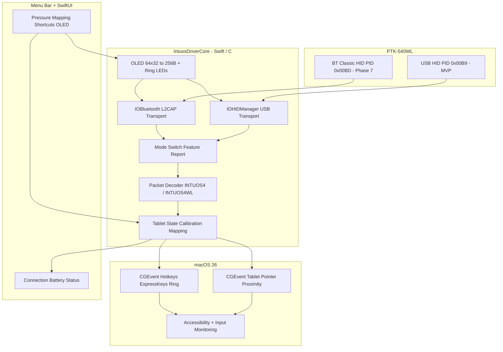

# Native Apple Silicon macOS Driver Plan: Wacom Intuos4 Wireless (PTK-540WL)

## 1. Goal

Build a **native arm64, user-space** driver and companion app for the **Wacom Intuos4 Wireless (PTK-540WL)** on **macOS 26 only** (target machine: macOS 26.4.1).

- Real HID I/O — not Rosetta, not the legacy Intel installer, not KEXT workarounds.
- MVP priority: **USB first**, then Bluetooth Classic.
- Drawing targets: **Adobe Photoshop / Illustrator** plus broad pro apps (Krita, Clip Studio, Affinity, Apple Notes).

Legacy reference in-tree: `Lates known driver not for Apple silicon/WacomTablet_6.3.41-2.dmg` (v6.3.41-2). That package is `hostArchitecture="x86_64"`, requires restart, ships `SiLabsUSBDriver64.kext`, daemons, and a deprecated `.prefPane`.

Related note: `driver.md` — native connection on Apple Silicon, not simulation of the old driver.

---

## 2. Decisions (locked)

| Decision | Choice |
| :--- | :--- |
| Architecture | Native `arm64` only (no universal / Intel requirement) |
| Minimum OS | **macOS 26** only |
| Driver model | User-space only (`IOHIDManager`, later `IOBluetooth` L2CAP). No KEXT, no SIP off |
| MVP transport | **USB first** (PID `0x00B9`), then Bluetooth Classic (PID `0x00BD`) |
| App integration | Real tablet events for **Adobe + broad pro apps** (not cursor-only MVP) |
| Protocol source of truth | **linuxwacom** (`wacom_wac.c` / `INTUOS4` / `INTUOS4WL`) + live USB capture; legacy binary only for OLED/report ID hints |
| UI | Menu bar app + SwiftUI settings (not `.prefPane`) |

---

## 3. Legacy Intel vs modern driver

| Feature | Legacy 6.3.41-2 | This project |
| :--- | :--- | :--- |
| Arch | `x86_64` only | Native `arm64` |
| Installer | `hostArchitecture="x86_64"`, restart required | Ad-hoc or notarized app / optional LaunchAgent |
| Driver model | KEXT (`SiLabsUSBDriver64.kext`) + daemons + privileged helpers | User-space HID + event injection |
| Pen path | Proprietary tablet daemon | `CGEvent` tablet pointer / proximity (full fields for Adobe) |
| Wireless | Legacy stack + system BT HID | **Deferred:** BT Classic via `IOBluetoothDevice` L2CAP (not CoreBluetooth) |
| ExpressKeys / ring | Daemon routing | Swift state engine + configurable shortcuts |
| OLED | `CPTKWLImageConverter` path | 64×32 → 256-byte buffers via HID output (linuxwacom-aligned) |
| UI | `.prefPane` (dead on modern macOS) | Menu Bar + SwiftUI |
| Security | Unsigned KEXT / SIP friction | Accessibility + Input Monitoring TCC only |

**Note:** `SiLabsUSBDriver64.kext` is not required for the pen/pad MVP (likely serial/firmware accessory path). Out of scope.

---

## 4. Hardware: PTK-540WL

| Item | Value |
| :--- | :--- |
| VID | `0x056A` (Wacom) |
| USB PID | `0x00B9` |
| Bluetooth PID | `0x00BD` |
| BT name | `PTK-540WL` |
| BT stack | **Bluetooth Classic 2.1+EDR, HID Profile** (not BLE) |
| Active area | 8.0" × 5.0" (203.2 × 127.0 mm) |
| Coordinates | Max X = `40640`, Max Y = `25400` (5080 LPI) |
| Pressure | 2048 levels (0–2047) |
| Tilt | ±60° (`-64`…`+63` on X/Y in Intuos4 encoding) |
| Controls | 8 ExpressKeys (each 64×32 mono OLED), Touch Ring (72 steps, 4 mode LEDs, center button) |
| Pairing | Discoverable ~180 s after pairing button; legacy PIN `0000` if prompted |

---

## 5. Architecture



**Process shape**

- Single **arm64** macOS app (Menu Bar extra + Settings window).
- Embedded library `IntuosDriverCore` (Swift; thin C for HID helpers if needed).
- Optional LaunchAgent after MVP for login start.
- No kernel extension; no DriverKit required for USB MVP.

---

## 6. Protocol notes (must not skip)

### 6.1 Mode switch (USB and BT)

After every open / reconnect, send Wacom **feature report mode switch** so the device leaves generic HID mouse mode and streams full Wacom reports.

- USB: HID `SET_REPORT` feature (same semantic as linuxwacom init).
- BT Classic: on HID Control L2CAP (PSM `0x0011`), bytes equivalent to `{0x53, 0x02, 0x02}` (SET_REPORT | Feature, report/mode payload per capture verification).
- Re-issue after **every** BT L2CAP reconnect — tablet resets mode on new session.

### 6.2 USB pen / pad (MVP)

- Match linuxwacom **INTUOS4** family parsing for PID `0x00B9`.
- Pen: X/Y, pressure, tilt, tip/eraser, barrel buttons, proximity, **tool ID** (out-of-band proximity/tool packets matter).
- Pad: ExpressKeys bitmask, Touch Ring position/mode, center button.
- Do not invent layouts — implement against linuxwacom + recorded fixtures.

### 6.3 Bluetooth Classic (Phase 7 only)

- **Not CoreBluetooth** (that is BLE). Use `IOBluetoothDevice` + L2CAP PSM `0x0011` (control) and `0x0013` (interrupt).
- BT reports are **batched**: report IDs `0x03` (~22 bytes, 2 pen frames) and `0x04` (~32 bytes, 3 pen frames) per linuxwacom `wacom_intuos_bt_irq`.
- Battery: status nibble + `batcap_i4[]` lookup (`{1,15,30,45,60,70,85,100}`), charging / AC flags — not a raw 0–100 byte alone.
- Risk: system `IOBluetoothHIDDriver` may claim the device; plan exclusive open / user steps / contention handling in Phase 7.

### 6.4 OLED / LEDs

- Each key: **64×32** 1-bit image → **256-byte** payload (linuxwacom / community Intuos4 WL path).
- Brightness and Touch Ring mode LEDs via HID output / feature reports (confirm IDs from capture + linuxwacom).
- Legacy `CPTKWLImageConverter` is a hint only; golden buffers from hardware beats guessing “nibbilize”.

### 6.5 Event injection (Adobe-critical)

- Emit `kCGEventTabletPointer` and `kCGEventTabletProximity` with full tablet fields (device ID, pointer type tip vs eraser, pressure normalized correctly, tilt, absolute X/Y).
- Avoid double-driving a plain mouse path that fights tablet events in Photoshop/Illustrator.
- Expect **app-specific iteration** in Phase 3 (pressure scale, proximity enter/leave ordering, tool type).
- ExpressKeys / ring → configurable keyboard shortcuts via `CGEvent` key events (needs Input Monitoring / Accessibility as applicable).

---

## 7. Phased implementation

### Phase 0 — Spec and capture harness

- Write internal protocol cheat-sheet from linuxwacom (`INTUOS4`, `INTUOS4WL`) + VID/PID table.
- Build a small USB HID sniffer (same transport stack as the driver) to record raw reports: pen hover, press, eraser, keys, ring, OLED writes if observable.
- Store golden fixtures under something like `Fixtures/usb/` for unit tests.
- Optional read-only strings/symbol pass on legacy `WacomTabletDriver` for OLED report IDs only.

**Exit:** Documented packet layouts + at least one real USB capture set from the PTK-540WL.

### Phase 1 — Scaffold and USB transport (`IntuosDriverCore`)

- Xcode (or SPM + app target), **macOS 26**, **arm64**.
- `IOHIDManager` discovery for VID `0x056A`, PID `0x00B9`.
- Connect / disconnect lifecycle; clear logging.
- Send **mode switch** immediately after open.
- Callback path delivering raw report bytes to the decoder stub.

**Exit:** Plug in USB → app logs continuous Wacom reports (not generic mouse-only junk).

### Phase 2 — Packet decoder and state engine

- Pen decoder: X/Y, pressure 0–2047, tilt, tip/eraser, barrel, proximity, tool ID.
- Pad decoder: 8 ExpressKeys, ring (72), mode, center button.
- Coordinate transform: tablet → target display(s); preserve aspect / full desktop / single display options.
- Pressure curve (user-editable LUT).
- Unit tests fed by Phase 0 fixtures.

**Exit:** Decoder tests green; live state visible in debug UI or logs.

### Phase 3 — Event synthesis (Photoshop / Illustrator gate)

- Inject tablet pointer + proximity events with sub-pixel positioning where applicable.
- Distinct tip vs eraser tool identity.
- Manual matrix: Photoshop, Illustrator, then Krita, Clip Studio, Affinity, Notes.
- Fix pressure dead zone, hover, and click-through issues per app.

**Exit:** Pressure-sensitive strokes work in **Photoshop and Illustrator** over USB; eraser and barrel buttons behave sanely.

### Phase 4 — ExpressKeys and Touch Ring

- Configurable bindings (defaults: Undo/Redo, brush size `[` `]`, zoom, etc.).
- Ring rotation → scroll/zoom/brush size by mode; center toggles mode.
- Drive ring mode LEDs when output reports are known.

**Exit:** Keys and ring usable while drawing without leaving the app.

### Phase 5 — OLED controller

- Render labels/icons to 64×32 1-bit; pack to 256 bytes; send per-key HID updates.
- Optional brightness control.
- Tests against golden frames.

**Exit:** Each ExpressKey shows a correct label/icon on device.

### Phase 6 — Menu bar app and settings UI

- Menu bar: connection state; battery placeholder until BT (USB may still expose charge state if present in reports).
- Settings: pressure curve, display mapping, key/ring bindings, OLED text.
- First-run TCC guidance (Accessibility, Input Monitoring).
- Optional “Open at login”.

**Exit:** Daily-driver UX without Console.app.

### Phase 7 — Bluetooth Classic

- Pairing documentation (button, `PTK-540WL`, PIN `0000` if needed).
- `IOBluetoothDevice` L2CAP control/interrupt; mode switch on every reconnect.
- Unwrap BT batch reports `0x03` / `0x04`; tool-ID proximity handling.
- Battery via `batcap_i4` + charging flags; menu bar percentage.
- Mitigate contention with system BT HID driver.

**Exit:** Wireless pen pressure works after pair/sleep/wake; battery visible.

### Phase 8 — Polish and release hygiene

- Code signing (ad-hoc for personal use, or Developer ID + notarization if distributing).
- Crash/reconnect resilience; sleep/wake; USB unplug during stroke.
- Automated parser + OLED tests in CI if desired.
- Short README: install, permissions, USB vs BT, troubleshooting.

**Exit:** Reliable personal daily use on macOS 26 Apple Silicon.

---

## 8. Verification strategy

### Automated

- Packet parser unit tests from recorded USB (and later BT) fixtures.
- Coordinate/pressure curve math tests.
- OLED 256-byte golden frame tests.

### Manual checklist

1. **USB PnP** — attach PTK-540WL; auto-attach; mode switch; reports flow.
2. **Adobe** — Photoshop + Illustrator pressure, tilt, eraser, hover.
3. **Other apps** — Krita, Clip Studio, Affinity, Notes.
4. **Mapping** — single and multi-display.
5. **ExpressKeys / ring** — shortcuts + mode LEDs.
6. **OLED** — labels update and persist across reconnect as designed.
7. **BT (Phase 7+)** — pair, draw, sleep/wake, battery, reconnect mode switch.
8. **Permissions** — fresh user account path: TCC prompts and recovery docs.

---

## 9. Risks

| Risk | Impact | Mitigation |
| :--- | :--- | :--- |
| Adobe tablet event quirks | High | Phase 3 gate on PS/AI; iterate event fields; compare with known-good tablet behavior |
| Wrong BT API (BLE vs Classic) | High if done early | BT deferred; L2CAP only; never CoreBluetooth for this model |
| System BT HID steals device | High on Phase 7 | Exclusive open research; user pairing steps; possible IOKit claiming strategy |
| OLED report IDs wrong | Medium | Capture + linuxwacom; no guess-only implementation |
| No official Wacom AS support for this model | Medium | linuxwacom + hardware capture as spec |
| macOS 26-only APIs | Low | Accept narrower OS; document if back-port ever needed |
| Competing mouse + tablet events | Medium | Suppress redundant mouse path; test click/drag in Adobe |

---

## 10. Out of scope

- Running or packaging legacy 6.3.41 under Rosetta as the product.
- `SiLabsUSBDriver64.kext` / SIP disable workflows.
- Wacom Desktop Center, Firmware Updater, or full Apple Events “Driver Request Interface” compatibility for third-party plugins that expect the official daemon.
- BLE / `CoreBluetooth` transport (wrong generation for PTK-540WL).
- Windows/Linux ports.
- Support for other Intuos4 PIDs unless needed as parser reference.

---

## 11. Suggested first delivery (MVP definition)

**USB MVP is done when:**

1. PTK-540WL on USB is discovered and mode-switched on macOS 26 arm64.
2. Pen moves with **pressure and tilt** in **Photoshop and Illustrator**.
3. Tip vs eraser work.
4. Basic ExpressKey shortcuts work.
5. Menu bar shows connected/disconnected.

OLED polish and Bluetooth are **post-MVP** (Phases 5 and 7).

---

## 12. Repo layout (target)

```text
Intuos driver/
  driver.md                 # original goal note
  driver_build.md           # this plan
  Lates known driver.../    # legacy DMG reference only
  IntuosDriver/             # Xcode project (to create)
    IntuosDriverCore/       # transport, parser, state, OLED, events
    IntuosDriverApp/        # Menu bar + SwiftUI
    Fixtures/               # golden USB/BT captures
    Tests/                  # parser + OLED unit tests
```

---

## 13. Immediate next steps

1. Create Xcode project scaffold (macOS 26, arm64) + `IntuosDriverCore` targets.
2. Implement Phase 0 sniffer + Phase 1 USB open/mode-switch/logging.
3. Capture fixtures from the physical PTK-540WL.
4. Implement Phase 2 decoder against linuxwacom + fixtures.
5. Phase 3 Adobe validation loop until PS/AI pressure is trustworthy.

Do not start Bluetooth or OLED until USB pen events are solid in Adobe apps.

## 14. Pointer/modifier investigation — 2026-10-04

Goran reports that the pointer still occasionally gets stuck and recovers after
pressing Command several times. The September click changes were previously
reported as improving behavior; this recurrence is not yet reproduced or fixed.

Verified during this review:

- Repository HEAD remains `128209b`; the installed `/Applications/IntuosDriver.app`
  executable matches the workspace bundle (SHA-256
  `a98dc56194cf6a6de506fe647fc4cc3608c17f9a27f6034f0e010ee25361ab5d`).
- Live HID and combined-session snapshots showed no Command/Shift/Option/Control
  keys or left/right mouse buttons held at inspection time.
- A 20-second listen-only observation saw 32 movement events, none carrying
  Command, and no clicks. The failing state was not captured.
- `TouchRingManager.postKey` still uses nil event sources and assigns shortcut
  flags directly to both key-down/up, without the ExpressKey shortcut lifecycle.
- `ExpressKeyManager.postCursorRefresh` posts the same non-tablet mouse movement
  directly to the foreground application and through the HID stream, including
  during modifier changes. This is a suspect input-sequence inconsistency, not
  a proven explanation of this recurrence.
- Application activation only resets ExpressKeys when the selected profile
  changes; switching between apps with the same profile leaves held state intact.
- The pointer regression runner injects a mock keyboard-flags closure. It does
  not exercise physical modifier release, event posting or app-switch delivery.
- Connection logs lack the modifier/click-state evidence needed for diagnosis.

Apple defines `hidSystemState` as the accumulated hardware-source table. No
evidence in this review establishes that a driver-generated event contaminated
that table. The local suppression-filter getter returned zero on fresh sources,
but Apple's documented defaults permit local keyboard/mouse input; suppression
cannot be diagnosed from that result alone.

Next investigation:

- [x] Clarify the reported trigger and behavior (2026-10-13, user-reported):
  Command-Tab/application switching precedes pen clicks adding files to the
  selection or behaving as right-clicks. The supplied Finder screenshot shows
  multiple discontiguous selected items.
- [ ] Capture physical modifier release and driver-generated event flags/buttons
  together during the failure, then correct and verify the responsible path.
  Current findings and observation limits are recorded below.


### Follow-up diagnosis — 2026-10-13

Goran reports Command-Tab getting locked during application switching, followed
by pen clicks continuing to select multiple files or behaving as right-clicks.
Discontiguous Finder selection is consistent with Command-click; Control-click
or a held barrel-button path can explain context menus. The screenshot alone
does not establish which input state is stuck.

Follow-up from Goran (2026-10-13, user-reported): the issue cannot be reproduced
right now. Whether Command-Tab alone triggers it without ExpressKeys or Touch
Ring use remains unknown.

Verified in this session:

- One IntuosDriver process was running from `/Applications/IntuosDriver.app`;
  the process listing showed no Wacom, OpenTabletDriver, Karabiner or
  BetterTouchTool process. This check does not exclude other input services.
- Installed and workspace bundle executables still share SHA-256
  `a98dc56194cf6a6de506fe647fc4cc3608c17f9a27f6034f0e010ee25361ab5d`.
- `swift run intuos-pointer-tests` completed eight scenarios with zero failed
  assertions. These tests replace keyboard flags and intercept output events;
  they cannot establish correct physical Command release or app-switch delivery.
- A short read-only state-table observation saw Command and Tab become active
  and later become inactive. Both mouse buttons were released at the end; no
  persistent Command/Control/Tab or mouse-button lock was established.
- The observer reported Accessibility and listen access as false. A listen-only
  tap object was created but supplied no event callbacks, so observation was
  limited to polling state tables and could not attribute events to the driver
  or establish delivery of physical key-up to applications.
- State-only evidence is saved at
  `~/Library/Logs/IntuosDriver/diagnostics/2026-10-13-state-observation.log`.
  It contains flags/button states, not typed text.

Concrete inconsistencies requiring investigation:

1. `RadialMenuController.postKey` still constructs nil-source events and sets
   Command/Shift/Option flags on both main-key down and up without separate
   modifier transitions. This path was missed by the earlier ExpressKey fix;
   Undo, Redo and Zoom all use it. `TouchRingManager.postKey` follows the same
   pattern for Option/Shift shortcuts. These are plausible modifier-latching
   paths, not proof of a failure caused by physical Command-Tab alone.
2. `AppProfileManager.applyProfile` returns early for the same profile. Switching
   between apps sharing the default profile therefore bypasses
   `AppDriverModel.appProfileDidChange` and its ExpressKey reset.
3. Profile-change cleanup resets ExpressKeys but does not release held pen mouse
   buttons. `TabletEventSynthesizer` releases those on subsequent pen input,
   proximity exit or disconnect, with no application-activation cleanup.
4. `ExpressKeyManager.postCursorRefresh` delivers the same plain mouse movement
   directly to the foreground PID and through the HID stream during modifier
   changes. This creates an extra delivery path alongside tablet events.

Apple documents HID and combined-session state tables separately, and says
local keyboard/mouse events are not suppressed by default. This review does
not establish hardware-table contamination or local-event suppression.
References:
- https://developer.apple.com/documentation/coregraphics/cgeventsourcestateid
- https://developer.apple.com/documentation/coregraphics/cgeventsource/localeventssuppressioninterval

Next action: obtain a failing event sequence with physical modifier transitions,
output event flags/buttons and the active application recorded together. Then
use one balanced shortcut implementation for the affected paths and verify
Command-Tab followed by ordinary pen clicks in Finder. Driver implementation
and the installed app were not changed by this diagnostic session.


## 15. Optional incident recorder — 2026-10-13

Goran requested an optional debug mode and will mark recurring input failures
by pressing Control four times. Implemented in the menu bar settings as
**Debug input recording**, off by default and persisted across restarts.

- Four distinct Control presses/releases within four seconds mark an incident
  after the fourth release. The marker does not consume or reset input events.
- A rolling in-memory buffer keeps up to 60 seconds / 12,000 records. Movement
  is sampled at five times per second; click/button/modifier transitions are
  recorded. Three seconds of activity after the marker are included.
- Records compare incoming pen/pad state, driver output events, observed
  session events, system modifier/button state, driver-held buttons/modifiers,
  profile changes and application activation (including same-profile switches).
- Only modifier keycodes and Tab are retained from keyboard observation. Other
  keycodes and typed text are excluded. No automatic recovery is performed.
- Incident JSONL files save asynchronously under
  `~/Library/Logs/IntuosDriver/diagnostics/`; the latest 20 reports are retained.
  Settings include **Save incident now** and **Open debug logs**.
- The passive event tap needs Input Monitoring. Settings provide permission
  guidance and report whether keyboard events have actually been observed.
  Pen/state recording and manual saving remain available without that access.

Validation:

- The existing eight pointer scenarios and new four-Control-tap checks passed
  with zero failed assertions, including duplicate transitions, slow taps and
  a held Control key followed by a valid gesture.
- An isolated recorder harness fed events into the actual callback without
  posting desktop input. It verified one automatic report, pre/post-marker
  context, valid JSONL and exclusion of ordinary keyboard keycodes.
- The release app compiled with the installed macOS 26.5 SDK and native SPM
  build system. The default macOS 27 SDK build hit unavailable SwiftUI macros
  in Command Line Tools; the packaging script now accepts explicit build args.
- Goran approved the Keychain prompt. Packaging and strict code-signature
  verification completed successfully. The new bundle has the same designated
  signing requirement as the installed app (identifier `com.trifa.intuosdriver`
  and certificate leaf `b696f2494bdd0c183505f13f3bd499d133084774`).
  Installation and restart were subsequently approved and completed, as
  recorded below.

Next actions:

- [x] Finish signing and verify the new debug bundle.
- [x] Install the signed debug build with approval for updating the running
  driver and enable debug recording.
- [ ] Verify one real four-Control-tap report (Input Monitoring may need enabling).
- [ ] Capture a recurrence and inspect the input sequence before changing the
  shortcut or app-switch behavior.


### Debug build installed — 2026-10-13

Goran approved replacing and restarting the installed driver. The previous app
was quit through its normal application termination path, which released the
tablet cleanly. A backup is preserved at:

`/Users/trifa/Library/Application Support/IntuosDriver/backups/20261013-142815/IntuosDriver.app`

The debug bundle was copied to `/Applications/IntuosDriver.app`. Strict signature
verification passed. Its executable matches the workspace bundle, SHA-256:
`caf07e7e429637578e701bcbb285d27b65f47905a767ee969d9b8b7ef4e2ec18`.

Debug recording is enabled in the `com.trifa.intuosdriver` preferences. Following
a clean restart, the process was confirmed running; the log reports
`accessibility=true` and reconnection to the PTK-540WL over USB, PID `0x00BC`.
A first immediate launch attempt raced the preceding app's shutdown; retrying
after confirming process exit succeeded.

Goran was asked to test the four-Control-tap marker. No real incident report
has been verified yet. Input Monitoring may need enabling through the debug
panel; the automated recorder checks do not establish live permission access.
